# 俞宣邑 Gurus 作品集範例

## 聯絡方式

- Email：1017johnny@gmail.com
- Number：0978687140

## 目錄

- [作品](#works)
  - [Dungeon｜Unity RPG](#dungeon)
    - [新手教學](#dungeon-tutorial)
    - [多樣地圖](#dungeon-maps)
    - [烹飪畫面](#dungeon-cooking)
  - [Spine 動畫作品](#spine)
    - [Slay The Spire](#spine-slay-the-spire)
    - [Ender Lilies](#spine-ender-lilies)
    - [二遊立繪](#spine-gacha)
    - [Q版動作](#spine-chibi)

  - [group_5｜日本旅遊票券網站](#group-5)
  - [大學專題｜互動陪伴機器人](#companion-robot)

## 作品 {#works}

### Dungeon｜Unity RPG {#dungeon}

獨立開發中的 Unity RPG，持續製作遊戲內容與玩法。

#### 新手教學 {#dungeon-tutorial}

<iframe src="https://www.youtube-nocookie.com/embed/PtXqxKuwxhU" title="Dungeon 新手教學" style="width: 100%; aspect-ratio: 16 / 9; border: 0;" loading="lazy" allow="accelerometer; clipboard-write; encrypted-media; gyroscope; picture-in-picture; web-share" referrerpolicy="strict-origin-when-cross-origin" allowfullscreen></iframe>

#### 多樣地圖 {#dungeon-maps}

<iframe src="https://www.youtube-nocookie.com/embed/MsYxmrSHlo4" title="Dungeon 多樣地圖" style="width: 100%; aspect-ratio: 16 / 9; border: 0;" loading="lazy" allow="accelerometer; clipboard-write; encrypted-media; gyroscope; picture-in-picture; web-share" referrerpolicy="strict-origin-when-cross-origin" allowfullscreen></iframe>

#### 烹飪畫面 {#dungeon-cooking}

<iframe src="https://www.youtube-nocookie.com/embed/qsA9nwJlou4" title="Dungeon 烹飪畫面" style="width: 100%; aspect-ratio: 16 / 9; border: 0;" loading="lazy" allow="accelerometer; clipboard-write; encrypted-media; gyroscope; picture-in-picture; web-share" referrerpolicy="strict-origin-when-cross-origin" allowfullscreen></iframe>

### Spine 動畫作品 ( 左:原動畫 | 右:換原動畫 ) {#spine}

#### Slay The Spire {#spine-slay-the-spire}

{: loading="lazy"}

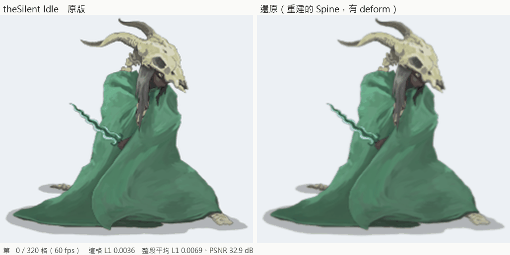{: loading="lazy"}

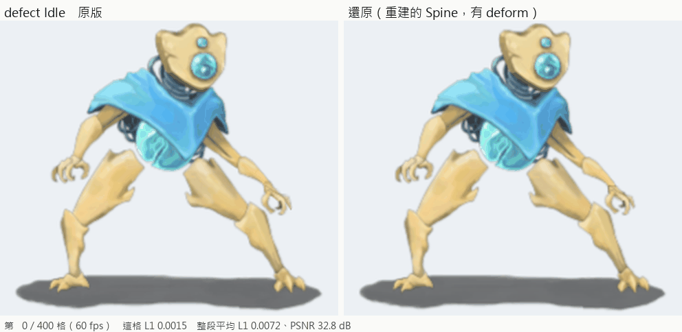{: loading="lazy"}

{: loading="lazy"}

#### Ender Lilies {#spine-ender-lilies}

{: loading="lazy"}

{: loading="lazy"}

{: loading="lazy"}

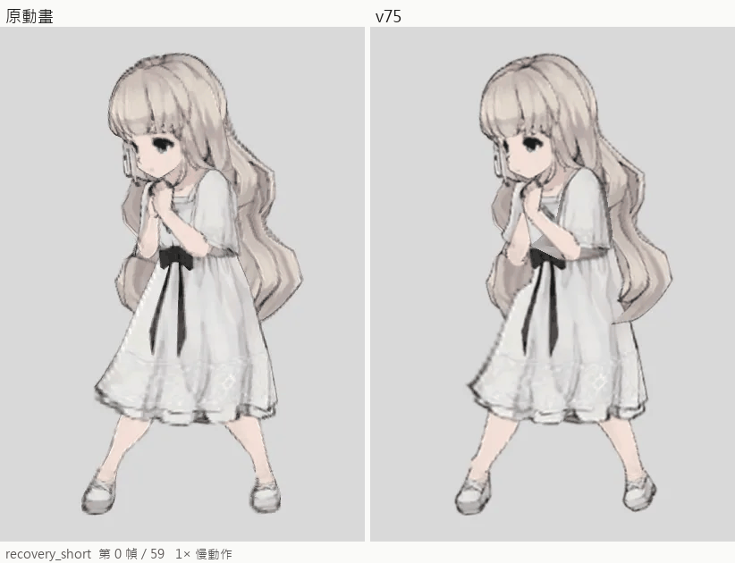{: loading="lazy"}

#### 二遊立繪 {#spine-gacha}

{: loading="lazy"}

{: loading="lazy"}

{: loading="lazy"}

{: loading="lazy"}

{: loading="lazy"}

{: loading="lazy"}

#### Q版動作 {#spine-chibi}

{: loading="lazy"}

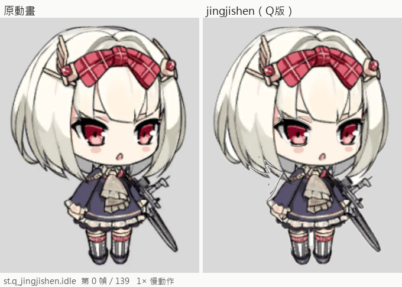{: loading="lazy"}

### group_5｜日本旅遊票券網站 {#group-5}

用 PHP 與 MySQL 實作旅遊票券網站，支援票券選購、購物車與已購買行程查詢。

#### 網站圖像

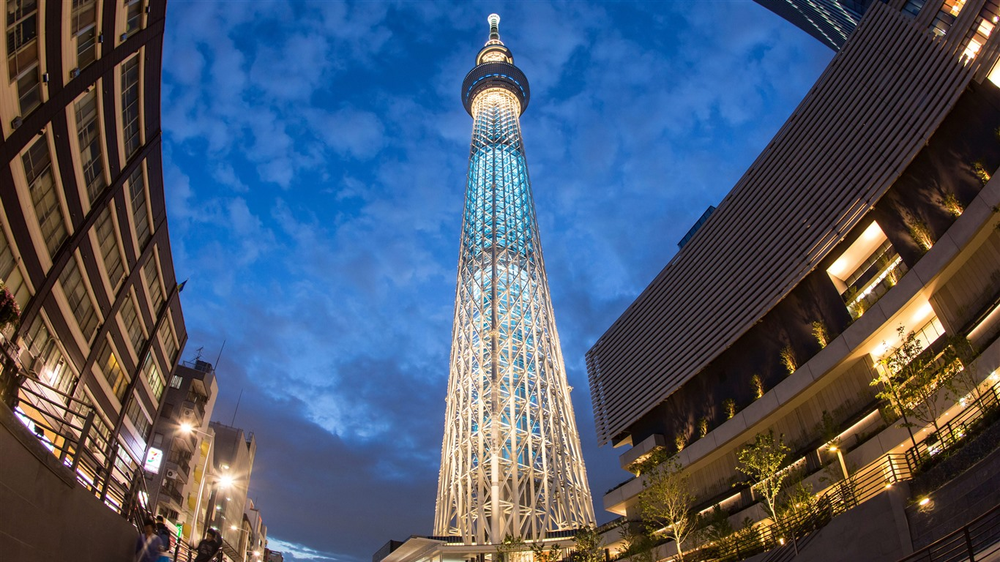{: loading="lazy" width="100%"}

原網站的首頁橫幅與熱門景點圖。

| 東京迪士尼樂園 | 晴空塔 |
| --- | --- |
| {: loading="lazy" width="100%"} | {: loading="lazy" width="100%"} |

| 淺草 | 東京鐵塔 |
| --- | --- |
| 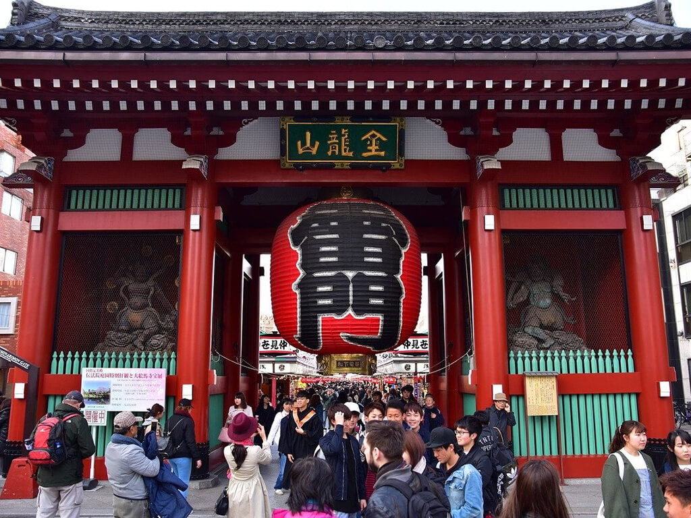{: loading="lazy" width="100%"} | 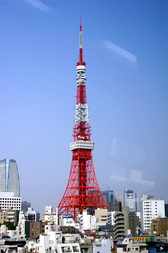{: loading="lazy" width="100%"} |

#### 票券選購與後端邏輯

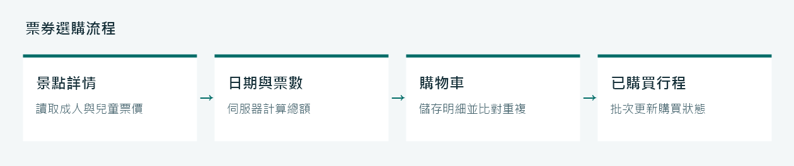{: loading="lazy" width="100%"}

- **後端計價**｜查詢成人與兒童票價，依張數計算總額，並保存單價與張數。
- **購物車防重複**｜以使用者、商品、月份與日期組成複合主鍵。

### 大學專題｜互動陪伴機器人 {#companion-robot}

以 Jetson Nano 與 JetBot 打造陪伴機器人原型，整合人臉辨識、手勢操控、語音對話與 Android App。

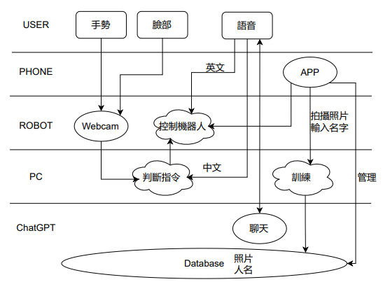{: loading="lazy" width="100%"}

**系統架構**｜串接手機、機器人、電腦、資料庫與 ChatGPT。

| 人臉辨識 | 手勢操控 |
| --- | --- |
| 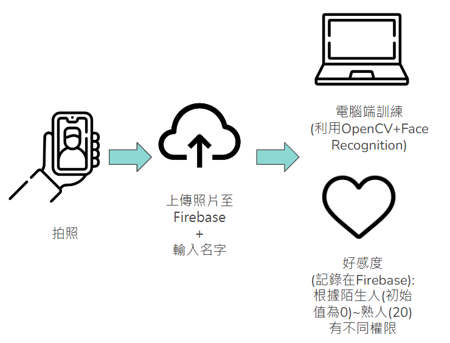{: loading="lazy" width="100%"} | {: loading="lazy" width="100%"} |
| 用 OpenCV 與 Face Recognition 辨識使用者。 | 用 MediaPipe 擷取手勢，轉成車體指令。 |

| 語音互動 | Android 控制 |
| --- | --- |
| 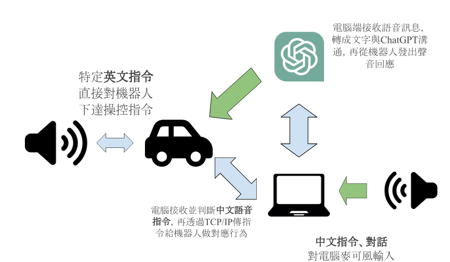{: loading="lazy" width="100%"} | {: loading="lazy" width="165"} |
| 將語音轉為文字，再由 ChatGPT API 產生回覆。 | 用手機發送方向與停止指令。 |

| 自動避障｜可通行樣本 | 自動避障｜有障礙樣本 |
| --- | --- |
| {: loading="lazy" width="260"} | 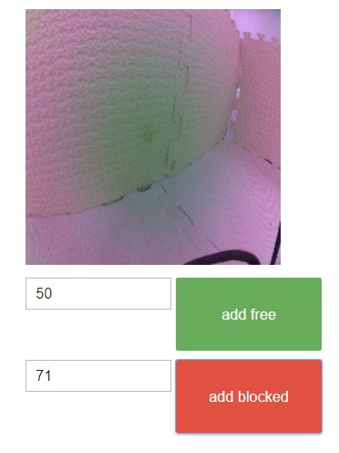{: loading="lazy" width="260"} |

專題圖例取自團隊的彰師大畢業專題報告。
